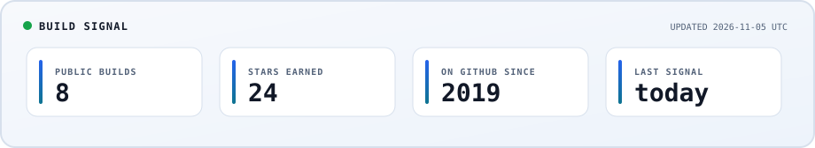

  <strong>中文</strong> · <a href="README.md">English</a>

<picture>
  <source media="(prefers-color-scheme: dark) and (max-width: 600px)" srcset="./assets/profile-header-zh-mobile-dark.svg">
  <source media="(max-width: 600px)" srcset="./assets/profile-header-zh-mobile-light.svg">
  <source media="(prefers-color-scheme: dark)" srcset="./assets/profile-header-zh-dark.svg">
  <source media="(prefers-color-scheme: light)" srcset="./assets/profile-header-zh-light.svg">
  
</picture>

## 你好，我是子涵。

我是一名在北京的 AI Agent 工程师，专注于 **Agent 系统、本地优先软件与产品界面设计** 的交叉领域。我希望把有野心的复杂系统，做得清晰、可控，并且真正有用。

最近，我在构建让人们自由使用自己的模型、也让不同 AI Agent 能够彼此协作的工具。

我把这些系统在生产环境里的真实表现——哪些成了，哪些炸了，代价是什么——写在博客里：**[zzihanaini.vercel.app](https://zzihanaini.vercel.app)** 📝

<!-- build-signal:start -->
<picture>
  <source media="(prefers-color-scheme: dark) and (max-width: 600px)" srcset="./assets/build-signal-mobile-dark.svg">
  <source media="(max-width: 600px)" srcset="./assets/build-signal-mobile-light.svg">
  <source media="(prefers-color-scheme: dark)" srcset="./assets/build-signal-dark.svg">
  <source media="(prefers-color-scheme: light)" srcset="./assets/build-signal-light.svg">
  
</picture>
<!-- build-signal:end -->

## 代表作品

<table>
<tr>
<td width="50%" valign="top">

 
由你自己的模型驱动的本地优先桌面 AI Agent——文件、终端、工具全掌控。
 
   
</td>
<td width="50%" valign="top">

 
AI Agent 的本地优先协作工作区，跨 CLI、设备与团队沟通与协作。
 
   
</td>
</tr>
<tr>
<td width="50%" valign="top">

 
日常开发技能与工程实践精选，经 CI 自动发布到 ClawHub。
 
   
</td>
<td width="50%" valign="top">

 
从 0 开始的 AI 知识地图：LLM → RAG → Agent → MCP → Coding Agent。
 
   
</td>
</tr>
<tr>
<td width="50%" valign="top">

 
把构建时间、版本与 Git 元数据注入 HTML，支持 Vite / Webpack / Rollup / Rspack / esbuild。
 
   
</td>
<td width="50%" valign="top">

 
个人博客与作品集，52 篇精选长文。React 19 · Supabase · Vercel Edge。
 
   
</td>
</tr>
<tr>
<td width="50%" valign="top">

 
浏览器扩展：把摸鱼的标签页变成安静专注的学习空间。
 
   
</td>
<td width="50%"></td>
</tr>
</table>

## 我正在探索

- **Agent 协作** — 让多 Agent 工作流真正跨工具、设备与团队运转。
- **本地优先 AI** — 保持模型选择自由、数据留在本地、控制权清晰可见。
- **界面工程** — 把复杂能力转化为平静、清楚、易理解的产品体验。
- **开发者工作流** — 用自动化缩短反馈链路，同时不把系统藏进黑盒。

## 常用工具

`TypeScript` · `React` · `Vite` · `Node.js` · `Tauri` · `Rust` · `Python` · `GitHub Actions`

我会围绕产品选择技术：多数界面和 Agent 工作使用 TypeScript；桌面系统边界需要可靠性时使用 Rust；自动化任务则常用 Python。

---

我很愿意认识同样认真思考 **AI 产品、前端系统、开源与 Agent 协作** 的朋友——欢迎从上面的项目开始，在合适的仓库提出想法或 Issue，也可以关注我看看接下来会发布什么。

 
觉得哪个项目有用，点个 Star 也是很实在的支持 · 带着好奇构建，用真实证据交付。

